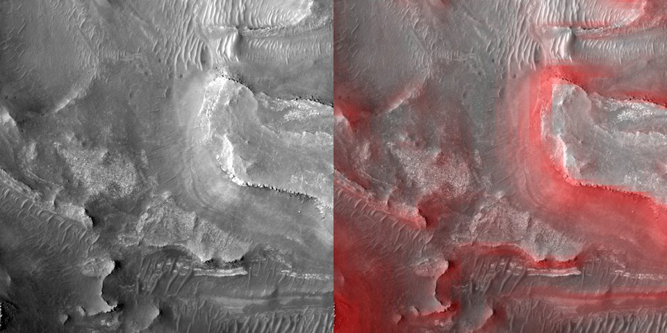
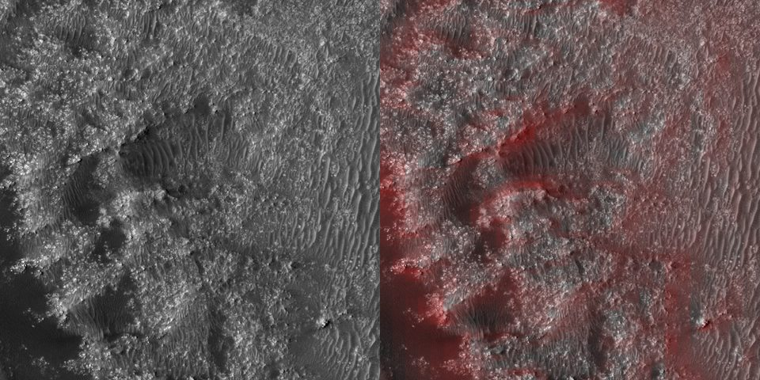
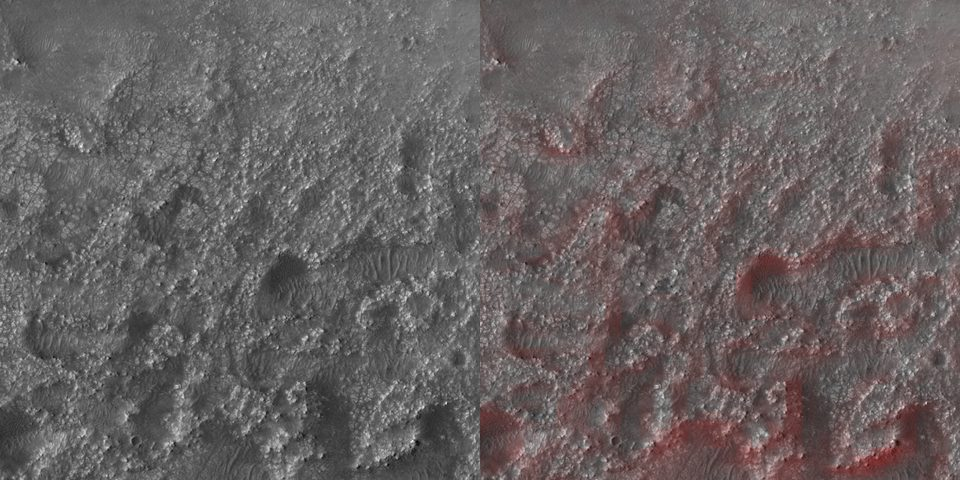

# Alignment validation against the Mars Trek HiRISE tiles

Issue #32. The question: do our terrain files sit where the HiRISE image the astronaut sees shows the relief? If `elevation.bin` were shifted, the route would avoid craters that are not there and cross ones that are.

**Result: no misalignment larger than one grid cell was found.** On three areas, the 1 m DTM sits within about 4 m of the Mars Trek image, `elevation.bin` within about 11 m (one cell is 19.7 m east–west and 11.6 m north–south), and our resampling to 512 × 512 adds less than 1 m. Read the limits below before quoting these numbers.

## What was compared

| Name | What it is |
|---|---|
| **image** | The Mars Trek HiRISE tile layer the app shows (`JEZ_hirise_soc_006_orthoMosaic_25cm_…_first_dd`), zoom 15, about 1.27 m per pixel |
| **dtm** | The 1 m HiRISE DTM that `elevation.bin` was made from |
| **grid** | Our `elevation.bin`, 512 × 512 cells of 19.7 × 11.6 m |

Three pairs are measured: **dtm vs image** (does the USGS terrain model agree with the tiles?), **grid vs image** (what the app really draws, the number that matters for the route) and **grid vs dtm** (what our resampling adds).

## Method

`pipeline/validate_alignment.py` cuts a 480 × 480 pixel square (about 580 m) around each area from the tiles and does this:

1. Samples the DTM and `elevation.bin` on the pixels of the image.
2. Brightness in the image is not elevation, so it compares **shading**: it finds the sun direction that makes a shaded relief of the DTM look most like the image (a Lambertian hillshade; the best sun came out near azimuth 270°, from the west, at a low angle), and renders the same shading for the grid.
3. Removes the slow brightness (albedo) with a band-pass filter, then computes a normalized cross-correlation (FFT) between the shaded relief and the image. The peak, refined to sub-pixel, is the shift in pixels, converted to meters at the latitude of the area.
4. Repeats for three scale bands of the filter, from fine (2 to 20 m) to coarse (8 to 80 m).

East and north are positive. Example: "east −3 m" means the terrain feature sits 3 m west of the same feature in the image.

## Result

The headline numbers use the finest band (2 to 20 m), the least affected by shadows (see "Why the fine band"). One grid cell is 19.7 m (east–west) by 11.6 m (north–south).

| Area | dtm vs image | grid vs image | grid vs dtm | Correlation peaks |
|---|---|---|---|---|
| **Delta scarp** (77.4040°E, 18.4620°N) | 3.3 m (E −3.0, N +1.4) | **6.5 m** (E −6.2, N +1.8) | 0.9 m | 0.59 / 0.46 / 0.67 |
| **Rocky terrain with a dune-filled hollow**, southwest of the landing site (77.4259°E, 18.4315°N) | 3.7 m (E −3.7, N +0.7) | **10.6 m** (E −10.4, N +1.9) | 0.3 m | 0.58 / 0.50 / 0.64 |
| **Pitted terrain with small hollows**, east of the landing site (77.4580°E, 18.4440°N) | 3.8 m (E −3.7, N +0.9) | **10.6 m** (E −10.5, N +1.3) | 0.4 m | 0.57 / 0.47 / 0.70 |

- **Every total shift is at most 10.6 m, below the smaller cell side (11.6 m).** Axis by axis: east–west at most 10.5 m against a 19.7 m cell (0.53 cell), north–south at most 1.9 m against 11.6 m (0.16 cell).
- **Our resampling adds almost nothing:** grid vs dtm is 0.3 to 0.9 m, under a tenth of a cell.
- The shift is almost purely east–west with the same sign in all three areas.

### All three scale bands

The same measurement with a coarser band shows the shift growing with the scale. Values are the total shift in meters.

| Area | dtm vs image, 2–20 m | 4–40 m | 8–80 m | grid vs image, 2–20 m | 4–40 m | 8–80 m |
|---|---|---|---|---|---|---|
| Delta scarp | 3.3 | 7.2 | 15.3 | 6.5 | 11.5 | 17.1 |
| Rocky terrain with a hollow | 3.7 | 9.3 | 17.2 | 10.6 | 14.6 | 20.5 |
| Pitted terrain | 3.8 | 8.2 | 13.3 | 10.6 | 13.4 | 16.0 |

### Why the fine band

A real georegistration error does not change with the scale you look at, and this one does: it triples from the fine to the coarse band, always toward the east, with the sun low in the west. That points to a bias of the method (the real image has cast shadows and brightness that a hillshade does not, and shadows fall away from the sun), not to a shifted file. The fine band is the least affected, so it is the best estimate, and the coarser bands are an upper bound. Even in the coarsest band, the largest value (20.5 m, grid vs image on the rocky terrain) is only 1.04 cells east–west, and the other five are under one cell.

## Captures

Left: the Mars Trek HiRISE tile. Right: the same tile with the slope of `elevation.bin` in red (the layer the app draws).

**Delta scarp.** The red follows the scarp edges and the steep ridges on the image.



**Rocky terrain with a dune-filled hollow, southwest of the landing site.**



**Pitted terrain with small hollows, east of the landing site.**



The images are small crops of the NASA Mars Trek HiRISE tiles (MRO/HiRISE, USGS), used as illustrations. See [data-sources.md](data-sources.md) for the source and terms.

## The app with the real data

With the development server of `web/` and the in-app browser on 2026-11-15:

- The page loaded `/data/meta.json`, `targets.geojson`, `missions.json` and `conditions.json` with HTTP 200, and `slope.bin` with HTTP 200 when the slope layer was turned on. The console showed **no errors** (only the Vite and React development notices).
- `elevation.bin` is read by the routing Worker. It is covered by `web/src/routing/realGrid.test.ts` and by the new `web/src/lib/loadDataReal.test.ts`, which load the real `meta.json`, `targets.geojson`, `missions.json`, `elevation.bin` and `slope.bin` from `public/data/` without errors.
- The app already loads the terrain meta, the targets and the missions in `real` mode (`DATA_SOURCES` in `web/src/App.tsx`).

## Limits

- **Three areas, one illumination.** All three come from the same HiRISE image, so they share the same sun, and the bias discussed above is shared too. We cannot separate a true shift of about 3 to 4 m from that bias. We only claim "no shift above about one cell", not meter-level accuracy.
- **Two of the areas are textured terrain, not isolated landmarks.** The method uses every edge in a 580 m square, which is steadier than picking one point, but it is not a measurement on a named crater.
- **The tiles have 1.27 m pixels** at zoom 15. Sub-meter values are below what we can see.
- **No traverse file.** The traverse GeoJSON (#27) does not exist, so the rover path was not overlaid. The targets are rover positions, and the grid agrees with the rover's own altitude at 390 stops (median 0.00 m, see [terrain-data.md](terrain-data.md)), which tests the same alignment from the vertical side.
- **The tile service may change.** The tiles were read on 2026-11-15 from `trek.nasa.gov`.
- Nothing was corrected: the shifts are below one cell, so neither the CRS nor the resampling was changed.

## Reproduce

The script downloads the tiles it needs (30 PNG files, about 1.7 MB) once into `data/raw/mars-trek-tiles/`, which git ignores:

```bash
pipeline/.venv/Scripts/python pipeline/validate_alignment.py --images docs/img
pipeline/.venv/Scripts/python -m pytest pipeline/tests/test_validate_alignment.py
```

The tests do not use the network: they check the shift finder on synthetic fields, the sign conventions, the hillshade and the tile georeferencing.
